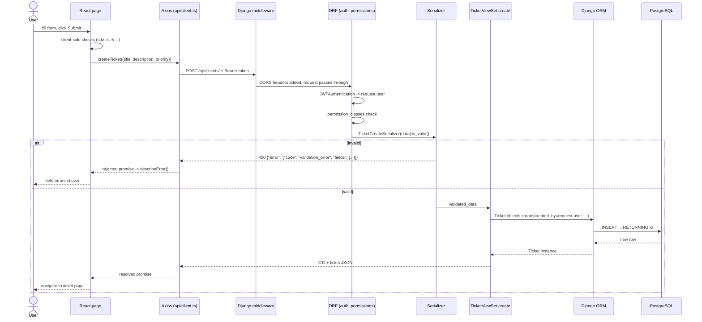

# Architecture

## 1. Big picture

Three processes talk over well-defined boundaries. Most real bugs are "which boundary broke?", so learn them.

```
React (browser)  --HTTP/JSON-->  Django REST API  --SQL-->  PostgreSQL
 src/                             backend/                    tables
```

Backend apps (Django "app" = a Python package grouping models, views and URLs for one concern):

* `accounts`: who you are (custom `User`, JWT endpoints, profile, admin user management).
* `tickets`: the core domain (`Ticket`, `Comment`, assignment/status rules, seed command).
* `dashboard`: read-only statistics; no models of its own.
* `config`: the project package (settings, root URLs, shared error handler/pagination, health check).

Deviation from the suggested layout: `config` also holds `pagination.py`, `exceptions.py`, `views.py`
(health). They are cross-cutting, so putting them in any one app would be wrong. No other deviations.

## 2. The request lifecycle: "customer creates a ticket"

Files involved, in order. Open each one as you read.

| # | Step | File : function |
|---|---|---|
| 1 | User fills the form | `frontend/src/pages/TicketCreatePage.tsx` (state via `useState`) |
| 2 | Client-side validation, build payload | same file, `onSubmit` (length checks, `createTicket({...})`) |
| 3 | Axios call | `frontend/src/api/tickets.ts: createTicket` → `api.post("/tickets/", …)`; `api/client.ts` request interceptor adds `Authorization: Bearer <access>` |
| 4 | URL routing | `backend/config/urls.py` (`path("api/", include("tickets.urls"))`) → `tickets/urls.py` (router maps `POST /tickets/` to `TicketViewSet.create`) |
| 5 | Middleware | `settings.MIDDLEWARE`: security, CORS (adds `Access-Control-*` headers), session, CSRF (skipped for token-authenticated API views) |
| 6 | Authentication | DRF `JWTAuthentication` (`settings.REST_FRAMEWORK`) verifies the token signature/expiry, loads `request.user` from the DB. Bad token → **401** |
| 7 | Permissions | `TicketViewSet.permission_classes = [IsAuthenticated, TicketObjectPermission]`. Not allowed → **403** |
| 8 | Serializer validation | `tickets/serializers.py: TicketCreateSerializer` (`validate_title`, `validate_description`, choice check on `priority`). Invalid → **400** via `config/exceptions.py` |
| 9 | View executes | `tickets/views.py: TicketViewSet.create` → `serializer.save(created_by=request.user, updated_by=request.user)` |
| 10 | ORM → SQL | `Ticket.objects.create(...)` becomes `INSERT INTO tickets_ticket (...) VALUES (...) RETURNING id` |
| 11 | PostgreSQL | checks NOT NULL, CHECK, FOREIGN KEY constraints; stores the row; returns the id |
| 12 | Response serialization | `_ticket_response` re-reads the ticket with joins and serializes with `TicketSerializer` → JSON, **201** |
| 13 | Axios receives | promise resolves with `response.data` typed as `Ticket` (`src/types/index.ts`) |
| 14 | React updates | `navigate("/tickets/<id>")`; `TicketDetailPage` loads it with `useFetch` showing loading → data/error |



### How the flow changes

* **Retrieve** (`GET /tickets/5/`): no serializer *input* validation. `get_queryset()` narrows rows by role first
  (`SELECT ... WHERE id = 5 AND created_by_id = <me>` for customers), so someone else's ticket yields **404**, not 403,
  and the existence of the ticket is not revealed. Then `get_object()` runs `TicketObjectPermission`.
* **Update** (`PATCH /tickets/5/`): same as retrieve to find the row, then `TicketUpdateSerializer(partial=True)`
  validates only the supplied fields; `validate()` enforces role rules (customers: no priority, only while open);
  `save()` issues `UPDATE tickets_ticket SET ... WHERE id = 5` (a plain `save()` writes every column of the row).
* **Unauthorized action**: no token → **401** (authentication failed: "who are you?"). Valid token but not
  allowed (customer calls `/assign/`) → **403** ("I know you, but no"). Allowed role but object hidden → **404**.
* **Database failure**: an `IntegrityError` (e.g. CHECK violated) is caught by `config/exceptions.py`, logged with
  the full cause, and returned as a generic JSON **500** without internals. A dead database raises
  `OperationalError`, which falls through to Django's own 500 (HTML debug page when `DEBUG=True`). Axios sees
  HTTP 500; `describeError` shows "Unexpected server response (HTTP 500)" when the body is HTML.
* **Unexpected response in the frontend**: Axios resolves for any 2xx and rejects otherwise. TypeScript types are
  *promises, not guarantees*: if the backend renames `assigned_to` to `assignee`, the code compiles and the UI shows
  `undefined`/crashes at runtime. Inspect the real JSON in the Network tab → Response and compare to `types/index.ts`.

## 3. Authentication design and trade-offs

* `POST /api/auth/login/` verifies the password (Django's PBKDF2 hash via `authenticate`) and returns a 15-minute
  **access token** (JWT) in JSON, plus a 7-day **refresh token** in an **HttpOnly cookie** scoped to `/api/auth/`.
* React keeps the access token **in memory only** (`api/client.ts`). Any JavaScript injected by an XSS bug could read
  `localStorage`, but cannot read an HttpOnly cookie, and an in-memory token disappears on reload.
* On reload `AuthProvider` calls `/auth/refresh/`; the browser attaches the cookie automatically
  (`withCredentials: true` + `CORS_ALLOW_CREDENTIALS`). On any 401 the Axios interceptor refreshes once and replays the request.
* **CSRF** (attacker site tricks your browser into sending cookies) matters only where a cookie *alone* authorises an
  action. Normal API calls need the Bearer header, which a foreign site cannot attach. The refresh endpoint is
  cookie-driven, but it only returns a token to whoever can read the response, which CORS denies to other origins, and
  `SameSite=Lax` stops the cookie being sent on cross-site POSTs. Django Admin (session cookies) uses normal CSRF protection.
* Trade-offs accepted: no refresh rotation/blacklist (a stolen refresh token keeps working for up to 7 days unless the account is
  deactivated; changing the password does NOT revoke it), no login throttling, logout only deletes the cookie client-side (the token itself is not revoked).
* Dev vs prod: `REFRESH_COOKIE_SECURE = not DEBUG`. In production the site must be HTTPS or the cookie is never sent.
  `localhost:5173` and `localhost:8000` count as the *same site* (ports are ignored for SameSite), so Lax cookies work in dev;
  with different domains in production you would need a shared parent domain or a reverse proxy serving both under one origin.

## 4. Role-based access

Roles live in `User.role` (`customer`, `agent`, `admin`), enforced in three layers:

1. **Queryset scoping** (`TicketViewSet.get_queryset`): customers only ever query their own tickets.
2. **Permission classes** (`accounts/permissions.py`, `tickets/permissions.py`): endpoint- and object-level rules.
3. **Serializer/service rules** (`TicketUpdateSerializer.validate`, `services.py`): field- and workflow-level rules.

Django's `Group`/`Permission` tables exist (we use `AbstractUser`) but we deliberately use one `role` column: three fixed
roles do not justify per-model permission assignments. If roles become configurable, switch to groups.
`is_staff` is separate: it only controls access to `/admin/`. `createsuperuser` users are forced to role `admin`.

## 5. Django components, one by one

For each: what / why / where / collaborators / typical bugs and how to investigate / Java-JS analogy.

### `settings.py` (`backend/config/settings.py`)
*What:* all configuration as Python variables. *Why:* Django reads it once at startup. *Collaborates with:* everything
(`INSTALLED_APPS` registers apps, `MIDDLEWARE` builds the request pipeline, `DATABASES`, `REST_FRAMEWORK`, `AUTH_USER_MODEL`).
*Bugs:* missing env var (`ImproperlyConfigured`, fails at startup, which is good), wrong DB host, app missing from
`INSTALLED_APPS` (models/migrations ignored), `CORS_ALLOWED_ORIGINS` typo (browser CORS error), `DEBUG=True` in production
(leaks secrets). *Investigate:* `python manage.py check`, `python manage.py diffsettings`, `print(settings.X)` in `shell`.
*Analogy:* `application.yml` + `@Configuration` in Spring; `.env` + `config.js` in Express.
*CORS vs CSRF:* CORS = which other **origins** may read responses in a browser (enforced by the browser, configured on the
server). CSRF = prevents cross-site requests that ride on cookies. Different problems, different symptoms.

### `urls.py` (`config/urls.py`, `accounts/urls.py`, `tickets/urls.py`, `dashboard/urls.py`)
*What:* maps URL patterns to views; `include()` nests tables; `SimpleRouter` generates the REST routes for a ViewSet.
*Bugs:* 404 from a missing trailing slash, wrong prefix, route shadowing (first match wins). *Investigate:* the 404 debug
page lists every pattern tried (DEBUG on); `python manage.py show_urls` is not built in, so use `python manage.py shell` →
`from django.urls import get_resolver`. *Analogy:* Express `app.use('/api', router)`; Spring `@RequestMapping`.

### `models.py` (`accounts/models.py`, `tickets/models.py`)
*What:* Python classes whose attributes are columns; one class = one table (`tickets_ticket`). Relationships are
`ForeignKey`. `Meta.constraints` and `Meta.indexes` become real PostgreSQL constraints/indexes. *Bugs:* changing a model
without a migration, `on_delete` surprises (`PROTECT` blocks deletes), N+1 queries from missing `select_related`.
*Investigate:* `showmigrations`, `sqlmigrate`, `dbshell` + `\d table`, `connection.queries`. *Analogy:* JPA `@Entity`
(but also the repository: `Ticket.objects.filter(...)` is like Spring Data).

### `serializers.py`
*What:* validates input and shapes output (DTO + Bean Validation in one). `ModelSerializer` derives fields from the model.
Method names `validate_<field>` run per field, `validate()` runs across fields. *Bugs:* field missing from `fields`
(silently not accepted/returned), `read_only` fields ignored on input, nested serializer N+1s, name mismatch with the
TypeScript type. *Investigate:* check the 400 body's `error.fields`; in `shell`, `Serializer(data=...).is_valid(); .errors`.
*Analogy:* Jackson DTO + `@Valid`; Joi/Zod schemas in Express.

### `views.py`
*What:* receives the request, calls serializer/ORM/services, returns a `Response`. `TicketViewSet` = one class per
resource with `list/create/retrieve/update/destroy`; `@action` adds custom routes. *Bugs:* wrong `get_queryset` (data leaks
or 404s), forgetting `raise_exception=True`, returning the wrong serializer. *Investigate:* add `logger.info` or a
breakpoint, read the traceback top-to-bottom for the first frame in *your* code. *Analogy:* `@RestController`; Express handler.

### `permissions.py` (`accounts/`, `tickets/`)
*What:* small classes with `has_permission` (endpoint) and `has_object_permission` (row). **Authentication = who are you
(401); authorization = may you (403).** *Bugs:* a customer reaching admin data, or legitimate users getting 403 because the
role check is wrong. *Investigate:* the 403 `message`, then trace which permission class returned False (`permission_classes`
on view/action). *Analogy:* Spring Security `@PreAuthorize`; Express auth middleware.

### `services.py` (`tickets/services.py`, `dashboard/services.py`)
Used **only** where it earns its place. `assign_ticket`/`change_status` do validate + update + add a system comment, which
must succeed together (`@transaction.atomic`) and are called from the API and tests. `ticket_stats` keeps aggregate SQL
out of the view. Simple CRUD stays in the viewset: adding a service layer there would be ceremony.

### `migrations/`
*What:* versioned scripts describing schema changes; Django records applied ones in the `django_migrations` table.
Model change → `makemigrations` writes a file → `migrate` runs SQL. *Bugs:* model changed but no migration ("column does not
exist"), migration unapplied, two branches creating conflicting `0002` files, editing an already-applied migration.
*Investigate:* `showmigrations`, `sqlmigrate app 0001`, `makemigrations --check`. *Analogy:* Flyway/Liquibase.

### Tests (`backend/tests/`)
pytest functions named `test_*`; fixtures in `conftest.py` provide users/tickets. `APIClient` makes real HTTP-shaped calls
through URL routing, auth, serializers and the real PostgreSQL test database. They catch regressions: after fixing a bug,
add a test that failed before the fix. *Analogy:* JUnit + MockMvc/Supertest (but with a real database).

### `admin.py`
Registers models in Django Admin (`/admin/`), an automatic CRUD UI. Useful to inspect and fix data during development;
it is not your product UI and needs `is_staff=True`. Registered here: User, Ticket (with inline comments), Comment.

### Middleware
Functions wrapped around every request, in `MIDDLEWARE` order (down on request, up on response). Here: security headers,
CORS, sessions, CSRF, auth (sessions, for Admin), messages, clickjacking. Add custom middleware for cross-cutting needs such as
request-ID logging or timing. Bug example: `CorsMiddleware` listed after `CommonMiddleware` → missing CORS headers on redirects.
*Analogy:* servlet filters; Express `app.use(fn)`.

Not created because not needed: custom `managers.py`, `signals.py`, `forms.py`/templates (we serve JSON, not HTML), `apps.py`
customisation (Django auto-generates an `AppConfig` for each app).

## 6. Error handling

`config/exceptions.py` gives every error the same shape: `{"error": {"status","code","message","fields?"}}`. The frontend
(`api/errors.ts`) turns it into `message` + per-field messages. Never return stack traces or SQL to clients; they are logged
server-side only.

## 7. Logging

`settings.LOGGING` prints to the console. Set `DJANGO_DEBUG=True` and `DJANGO_SQL_LOG=True` to print every SQL statement (the
SQL logger only emits in debug mode). Never log passwords, tokens or full request bodies of auth endpoints.

## 8. Local vs production

| Setting | Local development | Production |
|---|---|---|
| `DEBUG` | True | **False** (always) |
| `SECRET_KEY` | placeholder in `.env` | long random value from a secret manager |
| `ALLOWED_HOSTS` | localhost | your domain(s) only |
| HTTPS / cookies | HTTP; `Secure` cookie flag off | HTTPS required; `Secure`, HSTS on |
| Database | Docker container, disposable | managed PostgreSQL, backups, least-privilege user |
| Server | `runserver` | gunicorn/uvicorn behind nginx or a platform router |
| Migrations | run freely | reviewed, backed up first, applied in a controlled release |
| Destructive DB commands | acceptable on throw-away data | never as a debugging shortcut |

## 9. Python/Django security checklist (what this project does)

Passwords hashed with PBKDF2 (`create_user`, `set_password`); SQL injection avoided because the ORM parameterises
queries (never build SQL with f-strings; if you must use raw SQL, pass `params`); input validated server-side; permission
checks on every endpoint (default `IsAuthenticated`); mass-assignment avoided (serializers whitelist fields; `role` is
never writable by registration or `/auth/me/`); generic login error (no user enumeration); sensitive values only in env vars.

## 10. Needs review before any deployment

Rate limiting and lockout; refresh-token rotation/blacklist and logout revocation; password reset and email verification;
HTTPS and security headers (CSP); `python manage.py check --deploy`; dependency vulnerability scanning (`pip-audit`, `npm audit`);
database backups and restore drills; log retention and PII review; admin URL protection; a real server/process manager; CORS
and CSRF origins for the real domain; pagination/search performance on large data (add `pg_trgm` index for text search).
