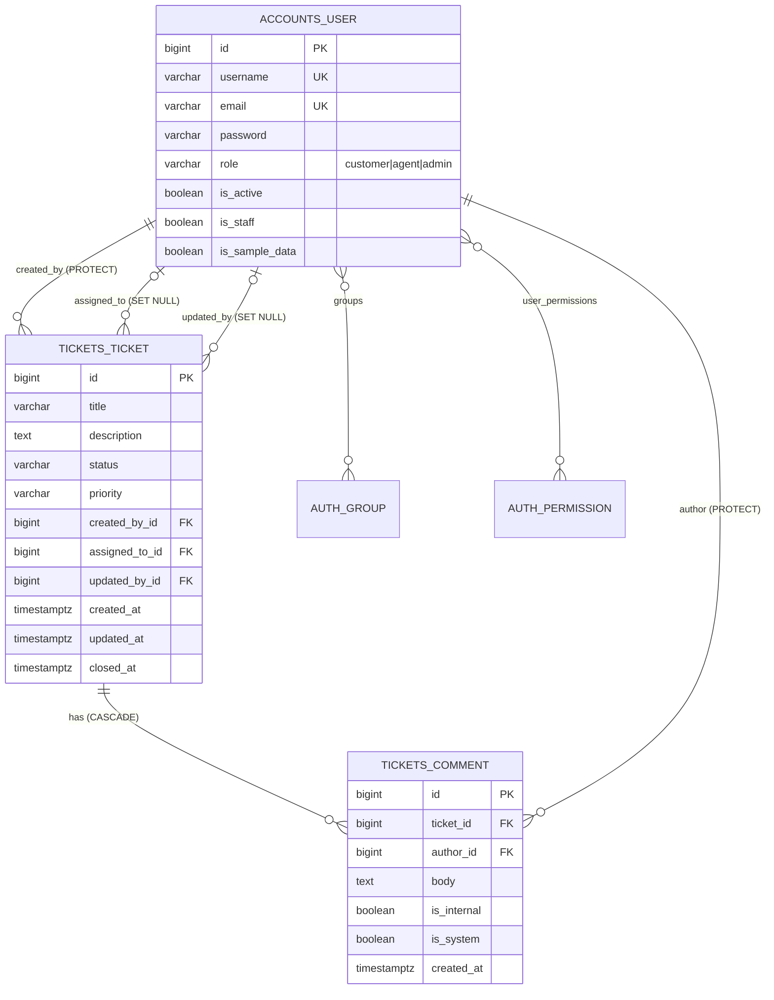

# Database guide (PostgreSQL 16 + Django ORM)

## 1. Architecture and configuration

Django talks to PostgreSQL through `psycopg` 3. Connection settings come from `.env` (see `DATABASES` in
`backend/config/settings.py`): `POSTGRES_DB`, `POSTGRES_USER`, `POSTGRES_PASSWORD`, `POSTGRES_HOST`, `POSTGRES_PORT`.
`CONN_MAX_AGE=60` reuses connections. Docker Compose starts `postgres:16` with a named volume `pgdata`, publishes it on
`127.0.0.1:${POSTGRES_HOST_PORT}`, and a health check makes the backend wait for it.

An empty database becomes the full schema with one command: `python manage.py migrate`.

**Credentials gotcha:** the Postgres image reads `POSTGRES_PASSWORD` only when it first initialises an empty volume. If you
change the password in `.env` later, the old one is still stored in the volume. Either set the new password inside the
database (`ALTER USER helpdesk PASSWORD '...'` in psql), or, on a throw-away dev database only, remove the volume
(`docker compose down -v`, which **destroys all data in it**; never do this on data you care about).

Connecting: `docker compose exec db psql -U helpdesk -d helpdesk`, `psql -h localhost -U helpdesk -d helpdesk`, or
`python manage.py dbshell`. pgAdmin: new server → host `localhost`, port `POSTGRES_HOST_PORT`, user/password from `.env`.

Useful psql commands: `\l` databases, `\dt` tables, `\d tickets_ticket` columns/indexes/constraints/FKs, `\di` indexes,
`\x` expanded output, `\q` quit. Explore with `EXPLAIN ANALYZE <query>;`.

## 2. Tables

Django names tables `<app>_<model>`. Also present (created by Django itself): `django_migrations` (applied migrations),
`django_content_type`, `django_admin_log`, `django_session`, `auth_group`, `auth_permission`, and the join tables
`accounts_user_groups`, `accounts_user_user_permissions`, `auth_group_permissions`.

### `accounts_user`: people (customers, agents, admins)
Why: Django's authentication system needs one user table; we extend `AbstractUser` (custom user model chosen *before the
first migration*, because swapping it later is painful). Passwords are stored as PBKDF2 hashes in `password`, never plain.

| Column | Type | Notes |
|---|---|---|
| `id` | bigint, PK, identity | surrogate key |
| `password` | varchar(128) NOT NULL | hash like `pbkdf2_sha256$...` |
| `last_login` | timestamptz NULL | |
| `is_superuser`, `is_staff`, `is_active` | boolean NOT NULL | `is_active=false` disables login (preferred over deleting) |
| `username` | varchar(150) NOT NULL **UNIQUE** | login name |
| `email` | varchar(254) NOT NULL **UNIQUE** | normalised to lowercase |
| `first_name`, `last_name` | varchar(150) NOT NULL (empty string allowed) | |
| `date_joined` | timestamptz NOT NULL | |
| `role` | varchar(16) NOT NULL, default `customer` | **CHECK** `user_role_valid`: customer / agent / admin |
| `is_sample_data` | boolean NOT NULL default false | marks seed-command rows |

### `tickets_ticket`: support requests
| Column | Type | Notes |
|---|---|---|
| `id` | bigint PK | |
| `title` | varchar(200) NOT NULL | |
| `description` | text NOT NULL | |
| `status` | varchar(20) NOT NULL default `open` | **CHECK** `ticket_status_valid` |
| `priority` | varchar(10) NOT NULL default `medium` | **CHECK** `ticket_priority_valid` |
| `created_by_id` | bigint NOT NULL **FK → accounts_user(id)** `ON DELETE` PROTECT | Django enforces PROTECT in Python; the DB FK itself is plain `REFERENCES` |
| `assigned_to_id` | bigint NULL FK → accounts_user | SET_NULL: deleting an agent un-assigns |
| `updated_by_id` | bigint NULL FK → accounts_user | audit: last editor |
| `created_at`, `updated_at` | timestamptz NOT NULL | audit timestamps |
| `closed_at` | timestamptz NULL | **CHECK** `ticket_closed_at_only_when_closed` |

Indexes (explicit, in `Meta.indexes`): `(status, priority)` for filtered lists; `(created_by_id, created_at DESC)` for "my
tickets, newest first"; `(assigned_to_id, status)` for an agent's workload and the dashboard; `(created_at DESC)` for the
default ordering. Django also creates a single-column index per foreign key automatically; the composite
`created_by`/`assigned_to` indexes make those partly redundant, which is acceptable here and a good review question
("which indexes could be dropped?", check with `pg_stat_user_indexes`).

### `tickets_comment`: conversation and audit trail
| Column | Type | Notes |
|---|---|---|
| `id` | bigint PK | |
| `ticket_id` | bigint NOT NULL FK → tickets_ticket **ON DELETE CASCADE (in Django)** | comment cannot exist without its ticket |
| `author_id` | bigint NOT NULL FK → accounts_user (PROTECT) | |
| `body` | text NOT NULL | **CHECK** `comment_body_not_empty` |
| `is_internal` | boolean NOT NULL | agents-only notes |
| `is_system` | boolean NOT NULL | generated by `services.py` (assignment/status change) |
| `created_at` | timestamptz NOT NULL | |

Index: `(ticket_id, created_at)` serves "comments of ticket X in order".

### Why this design
* **Roles as a column, not a table:** three fixed roles; a CHECK constraint guards it. A separate role table would add a join for no gain.
* **Normalised (3NF):** a person's details live once in `accounts_user`; tickets reference them by id, so renaming a user
  changes one row. We do not copy names into tickets.
* **Statuses as constrained strings** rather than a lookup table: readable in SQL, still validated by the database.
* **What the DB cannot express:** "assigned_to must be an agent" spans tables, so `services.assign_ticket` enforces it.
* **Constraints protect integrity even if the app has bugs:** every ticket has a creator (NOT NULL + FK), a comment belongs to
  a real ticket (FK), a status or priority outside the lists is rejected (CHECK), and a duplicate email is rejected (UNIQUE).

## 3. ER diagram



## 4. Queries: SQL and the equivalent ORM

Run SQL in `psql`; run ORM in `python manage.py shell`. Table names above; Django's quoting (`"tickets_ticket"`) omitted.

**List tickets (newest first, page 1 of 10)**
```sql
SELECT * FROM tickets_ticket ORDER BY created_at DESC, id DESC LIMIT 10 OFFSET 0;
```
```python
Ticket.objects.order_by("-created_at", "-id")[:10]      # slicing -> LIMIT/OFFSET
```

**Tickets created by a customer**
```sql
SELECT t.* FROM tickets_ticket t JOIN accounts_user u ON u.id = t.created_by_id WHERE u.username = 'alice.customer';
```
```python
Ticket.objects.filter(created_by__username="alice.customer")      # the double underscore follows the FK -> JOIN
```

**Tickets assigned to an agent**
```sql
SELECT * FROM tickets_ticket WHERE assigned_to_id = (SELECT id FROM accounts_user WHERE username = 'dave.agent');
```
```python
Ticket.objects.filter(assigned_to__username="dave.agent")
```

**Join tickets with users (what `select_related` does)**
```sql
SELECT t.id, t.title, c.username AS requester, a.username AS assignee
FROM tickets_ticket t
JOIN accounts_user c ON c.id = t.created_by_id
LEFT JOIN accounts_user a ON a.id = t.assigned_to_id;
```
```python
Ticket.objects.select_related("created_by", "assigned_to")   # one query; without it, each ticket.created_by is another query (N+1)
```

**Comments with authors**
```sql
SELECT c.created_at, u.username, c.body FROM tickets_comment c JOIN accounts_user u ON u.id = c.author_id
WHERE c.ticket_id = 3 AND c.is_internal = false ORDER BY c.created_at, c.id;
```
```python
Comment.objects.filter(ticket_id=3, is_internal=False).select_related("author")
```

**Count by status / dashboard statistics**
```sql
SELECT status, COUNT(*) FROM tickets_ticket GROUP BY status;

SELECT COUNT(*) AS total,
       COUNT(*) FILTER (WHERE status = 'open')   AS open,
       COUNT(*) FILTER (WHERE assigned_to_id IS NULL AND status <> 'closed') AS unassigned
FROM tickets_ticket;
```
```python
Ticket.objects.order_by().values("status").annotate(n=Count("id"))
Ticket.objects.aggregate(total=Count("id"), open=Count("id", filter=Q(status="open")))   # see dashboard/services.py
```
`order_by()` with no arguments clears the model's default ordering, which would otherwise be added to GROUP BY.

**Search and paginate** (what `?search=refund&page=2` becomes)
```sql
SELECT * FROM tickets_ticket t JOIN accounts_user u ON u.id = t.created_by_id
WHERE (UPPER(t.title) LIKE UPPER('%refund%') OR UPPER(t.description) LIKE UPPER('%refund%') OR UPPER(u.username) LIKE UPPER('%refund%'))
ORDER BY t.created_at DESC, t.id DESC LIMIT 10 OFFSET 10;
```
Leading-wildcard `LIKE` cannot use a normal B-tree index, so it scans the table. Fine for thousands of rows; for millions use PostgreSQL full-text search or a `pg_trgm` GIN index.

**Update a ticket**
```sql
UPDATE tickets_ticket SET priority = 'urgent', updated_by_id = 4, updated_at = now() WHERE id = 7;
```
```python
Ticket.objects.filter(pk=7).update(priority="urgent")      # one UPDATE, skips save() and auto_now
t = Ticket.objects.get(pk=7); t.priority = "urgent"; t.save()   # SELECT then UPDATE; refreshes updated_at
```

**Transactions** (`tickets/services.py: assign_ticket`)
```sql
BEGIN;
SELECT ... FROM tickets_ticket WHERE id = 7 FOR UPDATE;      -- lock the row
UPDATE tickets_ticket SET assigned_to_id = 4, status = 'in_progress' WHERE id = 7;
INSERT INTO tickets_comment (...) VALUES (...);                -- if this fails...
COMMIT;                                                        -- ...everything is ROLLBACKed instead
```
Why it matters: without the transaction, a crash between the UPDATE and the INSERT would leave a ticket assigned with no
audit comment. `test_failure_midway_rolls_back_the_whole_operation` proves it. `select_for_update` stops two agents from
changing the same ticket simultaneously (the second waits, then sees the first one's result).

**Inspecting what Django sends**
```python
# python manage.py shell
qs = Ticket.objects.filter(status="open").select_related("created_by")
print(qs.query)                  # SQL without executing
print(qs.explain(analyze=True))  # PostgreSQL's execution plan
from django.db import connection, reset_queries
from django.conf import settings; settings.DEBUG = True   # in the shell only
list(qs); print(len(connection.queries), connection.queries[-1]["sql"])
```
Or set `DJANGO_DEBUG=True DJANGO_SQL_LOG=True` and watch the server console. **Signs of inefficiency:** the query count grows with
the number of rows (N+1: fix with `select_related` for FKs / `prefetch_related` for reverse relations), `Seq Scan` on a big
table in `EXPLAIN` where you expected an index, fetching columns/rows you don't need (`.only()`, slicing). The test
`test_list_uses_constant_number_of_queries` guards the ticket list.

## 5. How ORM calls become SQL (mental model)

A `QuerySet` is a lazy description of a query. Chaining `.filter().order_by()` builds it; **evaluation** (iteration, `list()`,
slicing with a step, `len()`, `bool()`, `.get()`, `.count()`) sends SQL. `.get()` returns one object or raises
`DoesNotExist`/`MultipleObjectsReturned`; `.filter()` returns possibly-empty results. `.save()` = INSERT if no primary key, else
UPDATE. Duplicates in results usually come from joining across a many-valued relationship; use `.distinct()` or filter from the other side.

## 6. Migrations

```bash
python manage.py makemigrations tickets          # model change -> new file in tickets/migrations/
python manage.py sqlmigrate tickets 0001         # print the SQL a migration will run (does not run it)
python manage.py migrate                         # apply
python manage.py showmigrations                  # [X] applied, [ ] pending
python manage.py migrate tickets 0001            # move the schema to a specific migration (can reverse later ones)
```
Models changing does **not** change PostgreSQL by itself. The database only changes when a migration runs.
Truth sources: the files in `migrations/` (what *should* be applied, in order), the `django_migrations` table (what *was*
applied), and the real schema (`\d`). Bugs happen when these three disagree.

**Adding a field safely.** Example: add `due_date` to tickets.
1. Edit the model: `due_date = models.DateTimeField(null=True, blank=True)`. A nullable column needs no default and
   needs no table rewrite on PostgreSQL, so it is safe on a large live table.
2. `makemigrations tickets` → `0002_ticket_due_date.py` containing an `AddField`.
3. Read it, `sqlmigrate tickets 0002` (`ALTER TABLE ... ADD COLUMN "due_date" timestamptz NULL;`), run the tests, then `migrate`.
4. For a NOT NULL column on existing rows: add it nullable, backfill (a `RunPython` migration or SQL), then alter to NOT NULL
   in a later migration; never add NOT NULL without a default on a populated table.
5. Deploy order matters in production: migrate first for additive changes (old code ignores the new column); for removals, stop
   using the column in code first, deploy, then drop it.

**Conflicts:** two branches both create `0002_*` → `CommandError: Conflicting migrations detected`. Resolve with
`python manage.py makemigrations --merge`. Never edit or delete a migration that others (or production) have applied; add a new one.

## 7. Seeding

`python manage.py seed_demo_data` (needs `DJANGO_DEBUG=True`, and `SEED_PASSWORD` or `--password`) creates 6 sample users
(`is_sample_data=True`, `@example.test`), 12 tickets across all statuses/priorities, and comments. It uses `get_or_create`, so
running it again adds nothing. Inspect with:
```sql
SELECT username, role, is_sample_data FROM accounts_user ORDER BY id;
SELECT status, priority, COUNT(*) FROM tickets_ticket GROUP BY ROLLUP (status, priority) ORDER BY 1, 2;
```
```python
User.objects.filter(is_sample_data=True).values_list("username", "role")
```
To remove only sample rows later (dev database only): delete comments/tickets first, then users, because of PROTECT.

## 8. Backup and restore basics
```bash
docker compose exec -T db pg_dump -U helpdesk -d helpdesk --format=custom > backup.dump     # backup
docker compose exec -T db pg_restore -U helpdesk -d helpdesk --clean --if-exists < backup.dump  # restore (overwrites objects!)
```
Restore into an empty/throw-away database first to verify the backup works; an untested backup is a hope, not a backup.
Back up **before** applying migrations in production. Store backups outside the database host.

## 9. Common database errors

| Error | Meaning | Investigate |
|---|---|---|
| `OperationalError: connection refused` / `could not translate host name` | DB down or wrong host/port | `docker compose ps`; `POSTGRES_HOST` (`localhost` vs `db`); `/api/health/` |
| `FATAL: password authentication failed` | wrong credentials or stale volume password | compare `.env` to the volume's original password (section 1) |
| `FATAL: database "helpdesk" does not exist` | DB never created | check `POSTGRES_DB` before first `up` |
| `ProgrammingError: relation "x" does not exist` | migration not applied | `showmigrations`, `migrate` |
| `column "x" does not exist` | model ahead of schema | `makemigrations --check`, `migrate` |
| `IntegrityError: violates check constraint` | invalid status/priority/etc. | the message names the constraint; find the code path writing that value |
| `IntegrityError: violates foreign key constraint` | referencing a missing row | check the id; remember Django FK checks are deferred until commit |
| `IntegrityError: duplicate key ... unique` | duplicate username/email | find the existing row |
| `ProtectedError` on delete | `on_delete=PROTECT` rows reference it | deactivate (`is_active=False`) instead, or delete dependants first deliberately |
| Record saved but not shown in UI | scoping (`get_queryset`), filters, pagination page, or stale frontend state | query the table in psql; compare with the API response in DevTools |
| Duplicate rows in a list | join across a many-valued relation | print `qs.query`, add `.distinct()` |
